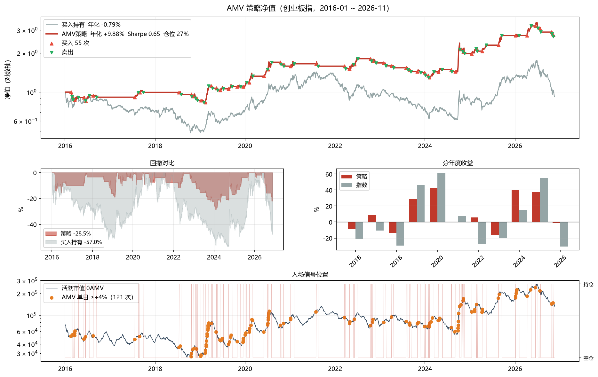
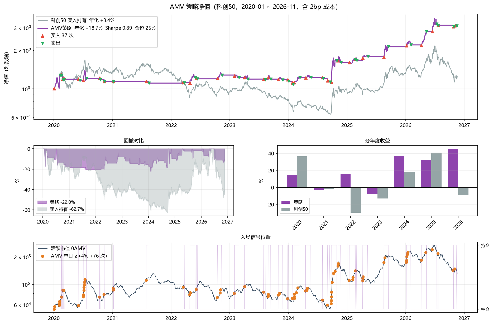

# 回测业绩总览

> 数据截至 2026-11-19 · 含 2bp 双边成本 · T 日信号 / T+1 日收盘执行
> 所有数字可用 `python run_backtest.py` 复现

---

## 一、核心业绩

| 标的 | 区间 | 年化 | Sharpe | 最大回撤 | 笔数 | 胜率 | 平均单笔 | 仓位 |
|---|---|---|---|---|---|---|---|---|
| **创业板指** | 2016-01 ~ 2026-11 | **+9.88%** | **0.65** | −28.5% | 55 | 40.0% | +2.29% | 27% |
| 科创50 | 2020-01 ~ 2026-11 | +8.53% | 0.48 | −39.5% | 37 | 32.4% | +2.07% | 25% |
| 上证指数 | 2016-01 ~ 2026-11 | +3.34% | 0.38 | −16.8% | 52 | 51.9% | +0.79% | 33% |

**同期买入持有**：创业板 −0.79%、科创50 +3.38%、上证 +0.78%

创业板 55 笔复利 **2.74 倍**（未扣成本），10.9 年折合年化 9.88%。

### 净值曲线

---

## 二、和原始规则对比

同一入场信号，只改出场方式：

| 规则 | 年化 | Sharpe | 最大回撤 | 笔数 | 胜率 |
|---|---|---|---|---|---|
| AMV +4% 进 / **−2.3% 出**（原始） | +3.96% | 0.31 | −43.7% | 50 | 46.0% |
| AMV +4% 进 / **持 20 天 / 止损 −3%** | **+9.88%** | **0.65** | **−28.5%** | 55 | 40.0% |

**年化是原来的 2.5 倍，回撤小 15 个百分点。**

---

## 三、分年度收益（创业板）

| 年份 | 策略 | 创业板指 | 超额 |
|---|---|---|---|
| 2016 | −8.6% | −21.2% | +12.6 |
| 2017 | +9.0% | −10.7% | +19.7 |
| 2018 | −13.3% | −29.3% | +16.1 |
| 2019 | +28.4% | +46.3% | −17.9 |
| 2020 | +42.8% | +61.8% | −19.0 |
| 2021 | −0.1% | +7.9% | −8.0 |
| 2022 | +5.9% | −27.8% | +33.7 |
| 2023 | −15.7% | −19.7% | +4.1 |
| 2024 | +40.0% | +15.4% | +24.6 |
| 2025 | +37.7% | +55.5% | −17.8 |
| 2026 | −1.5% | −30.4% | +28.9 |

**7 年跑赢，4 年跑输（2019/2020/2021/2025 全是牛市）**——仓位只有 27%，涨的时候跑不过满仓，这是择时策略的必然代价。

---

## 四、执行时点

| 执行方式 | 年化 | Sharpe | 回撤 |
|---|---|---|---|
| T 日收盘买（前视，不可执行） | +10.33% | 0.66 | −31.6% |
| **T+1 开盘买（推荐）** | **+13.13%** | **0.83** | **−26.1%** |
| T+1 收盘买（保守口径） | +10.12% | 0.66 | −28.3% |

**开盘买比收盘买每年多 3 个点**：AMV 信号次日，日内（开盘 → 收盘）平均 +0.42%、55% 为正，开盘买能吃到这一段。

> 信号日当天创业板平均涨 +3.28%（98% 收阳），但这段涨幅发生在你买入之前，不计入策略收益。

---

## 五、按位置分层（信号质量差异巨大）

信号发生时，指数距 250 日高点的回撤决定成败：

| 位置 | 信号数 | 后 20 日 | 胜率 | 后 60 日 | 胜率 |
|---|---|---|---|---|---|
| **深度回撤 < −25%** | 36 | **+7.20%** | 68% | **+9.55%** | **76%** |
| 中度 −25% ~ −15% | 21 | +3.84% | 57% | −2.66% | 24% |
| 轻度 −15% ~ −8% | 13 | +1.39% | 69% | −7.05% | 23% |
| **近高点 −8% ~ −2%** | 15 | **+0.22%** | **33%** | +2.74% | 60% |
| 创新高附近 > −2% | 28 | +4.49% | 71% | +1.39% | 61% |

**深跌区最肥（20 日 +7.20%、60 日 +9.55%、胜率 76%），近高点最差。**

建议按位置调仓：

| 位置 | 仓位 |
|---|---|
| 深跌 < −25% | 满仓 |
| 中度 / 轻度 | 半仓 |
| 近高点 −8%~−2% | **不做** |
| 创新高附近 | 正常 |

---

## 六、收益依赖度

| 处理 | 年化 |
|---|---|
| 全部 55 笔 | +9.88% |
| 剔除最好 1 笔（2024-09-02，+48.4%） | ≈ +3% |
| 前 5 笔占总收益 | **35%** |

**凸性策略：平时小亏小赚，等一次大的。实盘预期按 6–8% 规划。**

---

## 七、最近 10 笔交易（创业板）

| 买入 | 卖出 | 收益 | 持有天数 |
|---|---|---|---|
| 2025-01-15 | 2025-02-20 | +9.21% | 20 |
| 2025-02-24 | 2025-02-28 | −4.23% | 4 |
| 2025-04-09 | 2025-05-12 | +11.10% | 20 |
| 2025-08-19 | 2025-09-16 | +18.65% | 20 |
| 2026-01-06 | 2026-02-03 | +0.17% | 20 |
| 2026-04-09 | 2026-05-12 | +18.40% | 20 |
| 2026-06-16 | 2026-07-06 | −3.76% | 13 |
| 2026-07-22 | 2026-07-28 | −6.72% | 4 |
| 2026-10-26 | 2026-10-27 | −3.41% | 1 |
| 2026-11-05 | 2026-11-06 | −3.96% | 1 |

**最近 5 次入场信号 4 次失败**，其中 3 次发生在「指数已在跌、AMV 滞后」的状态。

---

## 八、风险提示

1. **统计不显著**：55 笔交易，t ≈ 1.2，p > 0.2
2. **样本短**：创业板 10 年、科创50 仅 6.6 年
3. **胜率低**：40%（科创50 32%），最长连续亏损 5 笔
4. **凸性依赖**：去掉 2024-09 那一笔，年化从 9.88% 降到约 3%
5. **成本假设**：按 2bp 计，实际 ETF 约 3–8bp
6. **数据来源**：AMV 为指南针专有指标，无公开 API

---

## 九、当前状态（2026-11-19）

| 项 | 值 |
|---|---|
| AMV 收盘 | 132,609.11 |
| 日涨跌 | −2.39% |
| 距历史峰值（2026-07-01） | **−50.6%** |
| 250 日区间分位 | **0.0%**（区间最低） |
| 创业板距 250 日高点 | **−47.5%**（深跌区） |
| 连续下跌 | 6 天（近 4 日 −9.04%） |
| 入场信号 | **未触发**（需 ≥+4%，差 6.39 个百分点） |

**位置已在历史最优档（深跌区，20 日胜率 68%、60 日胜率 76%），等一根放量阳线。**
