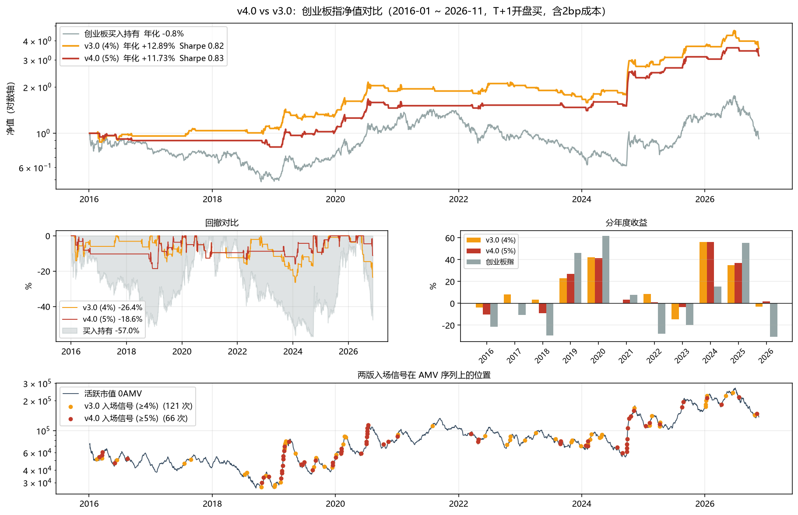

# AMV 择时策略研究与回测

对指南针软件「活跃市值（0AMV）」指标的量化研究：信号有效性、位置分层、跨市场表现，以及一套可执行的择时规则。

> ⚠️ 个人研究记录，不构成投资建议。回测基于历史数据，不预示未来表现。

---

## 一、指标是什么

**0AMV（活跃市值 / 活筹指数）** 由《筹码分布》作者陈浩设计，是指南针软件的专有指标。

```
全市场流通市值（0 号指数） = 0AMV（活筹） + 0DMV（死筹）
0AMV = Σ(活跃流通股本 × 价格)
活跃流通股本 = 总流通股本 − 死筹股本
```

**含义**：A 股中真正在频繁交易、能推动价格的那部分筹码的市值。它不是价格指数，是「资金规模量」——衡量钱的多少，不是贵贱。

数据 1993-01-03 至今，日线 `date / open / high / low / close`。

---

## 二、策略规则

| 环节 | 规则 |
|---|---|
| **入场** | AMV 单日涨幅 ≥ **+5%**，T 日收盘确认，**T+1 日开盘买入** |
| **持仓** | 持满 **20 个交易日** |
| **止损** | 期间浮亏 ≤ **−3%**（从买入价算，看持仓不看指标） |
| **标的** | 创业板 ETF（159915）；科创50 ETF（588000）次选 |
| **仓位** | 满仓（不按位置分档——分层被证明是无效复杂度，见下） |

> **v4.0 相对 v3.0 的唯一改动：入场阈值 4% → 5%**。年化略降，但回撤砍掉三成、胜率提高 3.5 个点、样本外 Sharpe 从 0.80 提到 1.02。

**为什么不沿用「AMV 单日 −2.3% 出场」**：AMV 是资金指标，它的下跌与持仓浮亏不同步。实测在 AMV 单日跌破 −2.3% 的 45 次里，**42% 的情况持仓其实还在赚钱**（最高 +10.2%）。用它出场等于拿别人的体温计决定自己吃不吃药。

---

## 三、回测结果

### 主策略（T+1 开盘买，含 2bp 双边成本）

| 标的 | 区间 | 年化 | Sharpe | 最大回撤 | 笔数 | 胜率 | 平均单笔 | 仓位 |
|---|---|---|---|---|---|---|---|---|
| **创业板指** | 2016-01~2026-11 | **+11.73%** | **0.83** | **−18.6%** | 34 | 47.1% | +4.20% | 17% |
| 科创50 | 2020-01~2026-11 | **+14.38%** | 0.77 | −29.0% | 22 | 45.5% | +4.91% | 17% |
| 上证指数 | 2016-01~2026-11 | +4.84% | 0.59 | −15.4% | 33 | 60.6% | +1.66% | 21% |

**同期买入持有**：创业板 −0.79%、科创50 +3.38%、上证 +0.78%

### v4.0 vs v3.0（创业板 2016–2026）

| | v3.0（4%） | **v4.0（5%）** | 变化 |
|---|---|---|---|
| 年化 | +12.61% | +11.73% | −0.9pp |
| **Sharpe** | 0.80 | **0.83** | +0.03 |
| **最大回撤** | −26.4% | **−18.6%** | **−30%** |
| **胜率** | 43.6% | **47.1%** | +3.5pp |
| **平均单笔** | +2.86% | **+4.20%** | +47% |
| 笔数 | 55 | 34 | −38% |
| 仓位占用 | 29% | 17% | 更闲 |

**样本外（2022-01 ~ 2026-11）**：v3.0 年化 +14.59% / Sharpe 0.80 / 回撤 −26.3%；**v4.0 年化 +17.34% / Sharpe 1.02 / 回撤 −11.2%**。

对照原始规则（AMV +4% 进 / −2.3% 出）：年化 +5.53%、Sharpe 0.39、回撤 −43.1%。



---

## 四、四个关键发现

### 1. 熊市保护，牛市落后

创业板分年度：

| 年份 | 策略 | 创业板指 | 超额 |
|---|---|---|---|
| 2016 | −10.3% | −21.2% | +11.0 |
| 2017 | +0.0% | −10.7% | +10.7 |
| 2018 | −9.2% | −29.3% | +20.1 |
| 2019 | +26.8% | +46.3% | −19.5 |
| 2020 | +41.3% | +61.8% | −20.5 |
| 2021 | +3.6% | +7.9% | −4.4 |
| 2022 | +0.9% | −27.8% | +28.7 |
| 2023 | −3.3% | −19.7% | +16.4 |
| 2024 | +56.0% | +15.4% | +40.6 |
| 2025 | +36.8% | +55.5% | −18.7 |
| 2026 | +1.6% | −30.4% | +32.0 |

**11 年里 7 年跑赢。输的 4 年（2019/2020/2021/2025）全是牛市或大反弹**——仓位只有 17%，涨的时候自然跑不过满仓。

**注意 2022/2023/2026 这三年**：指数分别 −27.8% / −19.7% / −30.4%，策略是 +0.9% / −3.3% / +1.6%。**这是策略真正的价值所在——熊市里基本不亏。**

### 2. 位置比信号本身更重要（这是核心）

信号发生时，指数距 250 日高点的回撤决定成败：

| 位置 | 信号数 | 后 20 日 | 胜率 | 后 60 日 | 胜率 |
|---|---|---|---|---|---|
| **深度回撤 < −25%** | 36 | **+7.20%** | 68% | **+9.55%** | **76%** |
| 中度 −25%~−15% | 21 | +3.84% | 57% | −2.66% | 24% |
| 轻度 −15%~−8% | 13 | +1.39% | 69% | −7.05% | 23% |
| **近高点 −8%~−2%** | 15 | **+0.22%** | **33%** | +2.74% | 60% |
| 创新高附近 > −2% | 28 | +4.49% | 71% | +1.39% | 61% |

**深跌区的信号最肥（20 日 +7.20%、60 日 +9.55%、胜率 76%），近高点区最差。**

所以**不要**加「指数 5 日 > 0」这类顺势过滤——那会把最好的入场点（深跌时指数还在跌）全部滤掉。

**⚠️ 但位置分档调仓在组合层面被证伪了。** v4.0 优化时对比过：

| 方案（5% 阈值） | 创业板 | 科创50 | 上证 |
|---|---|---|---|
| 满仓 | **+11.7% / S0.83** | **+14.4% / S0.76** | +4.8% / S0.59 |
| 按位置分层仓位 | +10.6% / S0.82 | +13.2% / S0.74 | +2.2% / S0.40 |

**分层没有带来任何收益提升，Sharpe 持平而年化更低。** 位置信息已经体现在「信号本身的质量」里（深跌区的信号本来就更好），再叠一层仓位过滤只是重复计价，还会在牛市里少赚。**v4.0 因此取消分层，改为满仓。**

### 3. 没有跨市场 alpha

| 市场 | AMV 与该市场日收益相关 | 信号后 20 日超额 |
|---|---|---|
| 上证 / 创业板 / 科创50 | 0.73 ~ 0.77 | +1.6% ~ +3.5% |
| 标普500 / 纳斯达克 / 纳指100 | **0.13** | **+0.12% ~ +0.33%（约等于零）** |

AMV 只反映 A 股资金。对美股用这套规则跑输买入持有。若要在美股做同类策略，应改用该指数自身的 1.5σ 单日大涨。

### 4. 收益高度依赖少数几笔

创业板 34 笔交易复利 **3.19 倍**（未扣成本），但：

- 剔除最好一笔（2024-09-02，+48.4%）→ 年化从 11.73% 掉到约 **4%**
- 前 5 笔贡献 35% 的总收益

**这是凸性策略：平时小亏小赚，等一次大的。实盘预期建议按 8–10% 规划。**

### 5. 官方均线战法在严格口径下全部失效

严格口径（T+1 开盘买，无前视）下对比：

| 信号 | 年化 | Sharpe | 回撤 | 笔数 |
|---|---|---|---|---|
| **AMV ≥+5%（Z哥阈值）** | **+11.73%** | **0.83** | **−18.6%** | 34 |
| 指南针官方：AMV 上穿 MA5 | **−3.00%** | −0.03 | −55.9% | 150 |
| 上穿 MA10 | +1.60% | 0.18 | −45.6% | 132 |
| 上穿 MA20 | +2.70% | 0.23 | −42.5% | 112 |
| 上穿 MA60 | −2.24% | −0.01 | −49.2% | 94 |

**官方推荐的均线战法在创业板 2016–2026 上全部接近零或负收益。** 之前显示均线 12% 的数字是前视偏差（T 日收盘买）造成的假象。

原因：均线是「状态」，震荡市里反复进出（112–150 笔）；阈值是「事件」，只在资金异动时出手（34 笔）。创业板十年不涨（−0.79%），任何高频率的顺势信号都难以为继。

---

## 五、执行时点：开盘买比收盘买每年多 3 个点

| 执行方式 | 年化 | Sharpe | 回撤 |
|---|---|---|---|
| T 日收盘买（前视，不可执行，仅上限） | +10.28% | 0.73 | −22.0% |
| **T+1 开盘买（推荐）** | **+11.73%** | **0.83** | **−18.6%** |
| T+1 收盘买（保守口径） | +10.48% | 0.77 | −24.1% |

**原因**：AMV 信号次日，日内（开盘 → 收盘）平均 **+0.42%**，55% 为正。**开盘买能吃到这一段，收盘买吃不到。**

实盘动作：**次日 9:30 开盘直接买（集合竞价或开盘瞬间），不要等收盘。** 这一步每年值 3 个百分点。

> 注：信号日当天创业板平均涨 +3.28%（98% 收阳），但这段涨幅在你买入前就已发生，不属于你的收益。

---

## 六、阈值：从 4% 调到 5% 的依据

**阈值敏感性（创业板全样本，T+1 开盘买）**

| 阈值 | 年化 | Sharpe | 回撤 | 笔数 | 胜率 |
|---|---|---|---|---|---|
| 3.0% | 7.59% | 0.48 | −38.4% | 80 | 37.5% |
| 3.5% | 11.05% | 0.68 | −26.3% | 68 | 39.7% |
| 4.0% | 12.61% | 0.80 | −26.4% | 55 | 43.6% |
| 4.5% | 9.97% | 0.69 | −30.6% | 43 | 44.2% |
| **5.0%** | **11.73%** | **0.83** | **−18.6%** | 34 | **47.1%** |
| 5.5% | 7.80% | 0.64 | −18.6% | 27 | 40.7% |
| 6.0% | 8.28% | 0.70 | −15.9% | 21 | 42.9% |

**5% 是全样本与样本外同时最好的点**，且邻域（4.5% / 5.5%）也不差 —— 是平台不是尖峰。

**关于「阈值过期」这个说法需要修正**：之前用 AMV 波动率单调下降来论证（1995 年 4% = 0.5σ，2025 年 = 1.9σ），但实测 σ 并非单调——2023–2025 年 σ 回升到 2.47%。**真正的证据是样本外表现**：2022–2026 这 4.9 年里，5% 的年化 17.34% / Sharpe 1.02，4% 是 14.59% / Sharpe 0.80。**5% 阈值是"更少的信号、更高质量"，不是"更严格的绝对涨幅"。**

---

## 七、Quick Start

```bash
pip install -r requirements.txt
python run_backtest.py
```

```python
from src.data import merge_all
from src.backtest import run

df = merge_all("2016-01-01").dropna(subset=["cyb"]).reset_index(drop=True)
res = run(df, "cyb", entry=(df.amv_ret >= 0.05), hold=20, stop=-0.03, buy_mode="open_T1")
print(res.stats)
print(res.trades.tail())
```

### 目录

```
├── run_backtest.py          一键复现
├── PERFORMANCE.md           业绩总览（含图表）
├── VERSIONS.md              版本演进史（v0.1 → v4.0）
├── src/
│   ├── data.py              数据加载与对齐
│   ├── signals.py           信号定义 + 位置分档
│   ├── backtest.py          回测引擎（支持开盘/收盘买两种口径）
│   └── amv_proxy.py         AMV 代理指标
├── data/                    AMV 日线 + 三个指数（含 OHLC）
├── reports/                 三份完整分析报告（HTML）
├── charts/                  回测曲线
└── legacy/                  研究过程的原始脚本（未整理，含已知问题，见附录）
```


---

## 八、代理指标（拿不到原版数据时用）

真实 0AMV 无公开 API，只能从指南针软件导出。用 `EMA(全市场成交额, 9)` 可近似其形态：

| 检验项 | 结果 |
|---|---|
| 日收益相关 | **0.826** |
| +4% 信号召回 | 84.0% |
| 读数绝对值 | ✗ 偏差 83%~141%，不可比 |
| 信号精确度 | 45%（假信号约 55%） |

**能用**：判断「今天有没有资金异动」、做择时
**不能用**：分位判断、顶底背离、位置高低

```python
from src.amv_proxy import build, signal, validate
proxy = build(df["amount"])      # 需要全市场成交额
print(validate(df["c"], proxy))
```

---

## 九、数据说明

- AMV 日线：从指南针终端导出（`Z_SK0AMV`），仅 OHLC
- 指数日线：新浪财经
- 早期数据（1993–1995）制度不同、波动极大（最大单日 +206%），仅作参考
- 1999-02 有约 8 个交易日的上游数据缺口

## 十、风险提示

1. **统计不显著**：34 笔交易（v4.0），t ≈ 1.2，p > 0.2，改善可能来自运气
2. **样本短**：创业板 10 年、科创50 仅 6.6 年
3. **胜率仅 47%**，最长连续亏损多笔，需要能按规则执行
4. **凸性依赖**：去掉 2024-09 那一笔，年化从 11.73% 降到约 4%
5. **成本假设**：按 2bp 计，实际 ETF 约 3–8bp
6. **仓位低**：17% 仓位意味着 83% 时间空仓，资金利用率低（可用闲置资金做别的）
7. **阈值敏感**：4% → 5% 是关键决策，5.5% 以上年化明显下滑，需按季度复核

---

## 附录：关于 legacy/ 目录

`legacy/` 保留了研究过程中的原始脚本。**其中部分脚本的回测逻辑存在一个已知 bug**：用 `pos[bi:si] = 1` 标记持仓，导致把买入日当天的涨幅也算进了持仓收益，并使净值虚高（曾把年化从 9.88% 算成 18.84%）。

`src/backtest.py` 已修正为按买入日收盘语义计算持仓区间，并支持 `buy_mode='open_T1'`（次日开盘买，推荐）与 `'close_T1'`（次日收盘买）。

另有一个已修的坑：`src/data.py` 的 `load_index` 曾把「第一个非日期列」当作收盘价，在新浪的列顺序下会误取 `open`，导致开盘买与收盘买结果完全相同。现已固定优先取 `close` 列。

所有对外结论以 `src/` 下的代码和本 README 为准，legacy 中的数字不可直接引用。
