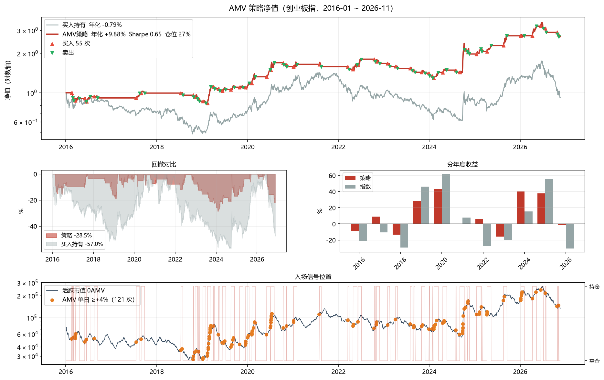

# AMV 择时策略研究与回测

对指南针软件「活跃市值（0AMV）」指标的量化研究：信号有效性、位置分层、跨市场表现，以及一套可执行的择时规则。

> ⚠️ 个人研究记录，不构成投资建议。回测基于历史数据，不预示未来表现。

---

## 一、指标是什么

**0AMV（活跃市值 / 活筹指数）** 由《筹码分布》作者陈浩设计，是指南针软件的专有指标。

```
全市场流通市值（0 号指数） = 0AMV（活筹） + 0DMV（死筹）
0AMV = Σ(活跃流通股本 × 价格)
活跃流通股本 = 总流通股本 − 死筹股本
```

**含义**：A 股中真正在频繁交易、能推动价格的那部分筹码的市值。它不是价格指数，是「资金规模量」——衡量钱的多少，不是贵贱。

数据 1993-01-03 至今，日线 `date / open / high / low / close`。

---

## 二、策略规则

| 环节 | 规则 |
|---|---|
| **入场** | AMV 单日涨幅 ≥ **+4%**，T 日收盘确认，**T+1 日收盘买入** |
| **持仓** | 持满 **20 个交易日** |
| **止损** | 期间浮亏 ≤ **−3%**（从买入价算，看持仓不看指标） |
| **标的** | 创业板指 → 实盘创业板 ETF |

**为什么不沿用「AMV 单日 −2.3% 出场」**：AMV 是资金指标，它的下跌与持仓浮亏不同步。实测在 AMV 单日跌破 −2.3% 的 45 次里，**42% 的情况持仓其实还在赚钱**（最高 +10.2%）。用它出场等于拿别人的体温计决定自己吃不吃药。

---

## 三、回测结果

### 主策略（T+1 收盘执行，含 2bp 双边成本）

| 标的 | 区间 | 年化 | Sharpe | 最大回撤 | 笔数 | 胜率 | 平均单笔 | 仓位 |
|---|---|---|---|---|---|---|---|---|
| **创业板指** | 2016-01~2026-11 | **+9.88%** | **0.65** | −28.5% | 55 | 40.0% | +2.29% | 27% |
| 科创50 | 2020-01~2026-11 | +8.53% | 0.48 | −39.5% | 37 | 32.4% | +2.07% | 25% |
| 上证指数 | 2016-01~2026-11 | +3.34% | 0.38 | −16.8% | 52 | 51.9% | +0.79% | 33% |

**同期买入持有**：创业板 −0.79%、科创50 +3.38%、上证 +0.78%

对照原始规则（AMV +4% 进 / −2.3% 出）：创业板年化 **+3.96%**、Sharpe 0.31、回撤 −43.7%。



---

## 四、四个关键发现

### 1. 熊市保护，牛市落后

创业板分年度：

| 年份 | 策略 | 创业板指 | 超额 |
|---|---|---|---|
| 2016 | −8.6% | −21.2% | +12.6 |
| 2017 | +9.0% | −10.7% | +19.7 |
| 2018 | −13.3% | −29.3% | +16.1 |
| 2019 | +28.4% | +46.3% | −17.9 |
| 2020 | +42.8% | +61.8% | −19.0 |
| 2021 | −0.1% | +7.9% | −8.0 |
| 2022 | +5.9% | −27.8% | +33.7 |
| 2023 | −15.7% | −19.7% | +4.1 |
| 2024 | +40.0% | +15.4% | +24.6 |
| 2025 | +37.7% | +55.5% | −17.8 |
| 2026 | −1.5% | −30.4% | +28.9 |

**11 年里 7 年跑赢。输的 4 年（2019/2020/2021/2025）全是牛市或大反弹**——仓位只有 27%，涨的时候自然跑不过满仓。

### 2. 位置比信号本身更重要（这是核心）

信号发生时，指数距 250 日高点的回撤决定成败：

| 位置 | 信号数 | 后 20 日 | 胜率 | 后 60 日 | 胜率 |
|---|---|---|---|---|---|
| **深度回撤 < −25%** | 36 | **+7.20%** | 68% | **+9.55%** | **76%** |
| 中度 −25%~−15% | 21 | +3.84% | 57% | −2.66% | 24% |
| 轻度 −15%~−8% | 13 | +1.39% | 69% | −7.05% | 23% |
| **近高点 −8%~−2%** | 15 | **+0.22%** | **33%** | +2.74% | 60% |
| 创新高附近 > −2% | 28 | +4.49% | 71% | +1.39% | 61% |

**深跌区的信号最肥（20 日 +7.20%、60 日 +9.55%、胜率 76%），近高点区最差。**

所以**不要**加「指数 5 日 > 0」这类顺势过滤——那会把最好的入场点（深跌时指数还在跌）全部滤掉。正确做法是按位置调仓：

| 位置 | 仓位 |
|---|---|
| 深跌 < −25% | 满仓 |
| 中度 / 轻度 | 半仓 |
| 近高点 −8%~−2% | 不做 |
| 创新高附近 | 正常 |

### 3. 没有跨市场 alpha

| 市场 | AMV 与该市场日收益相关 | 信号后 20 日超额 |
|---|---|---|
| 上证 / 创业板 / 科创50 | 0.73 ~ 0.77 | +1.6% ~ +3.5% |
| 标普500 / 纳斯达克 / 纳指100 | **0.13** | **+0.12% ~ +0.33%（约等于零）** |

AMV 只反映 A 股资金。对美股用这套规则跑输买入持有。若要在美股做同类策略，应改用该指数自身的 1.5σ 单日大涨。

### 4. 收益高度依赖少数几笔

创业板 55 笔交易复利 **2.74 倍**（未扣成本），但：

- 剔除最好一笔（2024-09-02，+48.4%）→ 年化从 9.88% 掉到约 **3%**
- 前 5 笔贡献 35% 的总收益

**这是凸性策略：平时小亏小赚，等一次大的。实盘预期建议按 6–8% 规划。**

---

## 五、执行时点：差别很小

| 执行方式 | 年化 | Sharpe |
|---|---|---|
| T 日收盘买 | +10.09% | 0.65 |
| **T+1 收盘买（本项目口径）** | **+9.88%** | 0.65 |
| T+2 收盘买 | +8.05% | 0.54 |

差一天只差 0.2 个百分点。**不必为了抢一天去做盘中实时估算 AMV，收益差异不值得那个操作风险。**

> 注：信号日当天创业板平均涨 +3.28%（98% 收阳），但这段涨幅在你买入前就已发生，不属于你的收益。

---

## 六、阈值正在过期

| 年代 | AMV 日波动 σ | +4% 相当于 | 触发频率 |
|---|---|---|---|
| 1995–1999 | 7.39% | 0.5σ | 14.7% |
| 2005–2009 | 3.43% | 1.2σ | 10.7% |
| 2015–2019 | 2.39% | 1.7σ | 5.6% |
| **2025–2029** | **2.10%** | **1.9σ** | **4.4%** |

同一个 4%，从「每天都能见到的普通放量」变成「一年只有 11 次的极端事件」。若要长期使用，建议改成 **1.5–1.8 × 60 日滚动 σ**。

---

## 七、Quick Start

```bash
pip install -r requirements.txt
python run_backtest.py
```

```python
from src.data import merge_all
from src.signals import amv_surge, position_bucket
from src.backtest import run

df = merge_all("2016-01-01").dropna(subset=["cyb"]).reset_index(drop=True)
df["bucket"] = position_bucket(df, "cyb")
res = run(df, "cyb", entry=amv_surge(df), hold=20, stop=-0.03, lag=1)
print(res.stats)
print(res.trades.tail())
```

### 目录

```
├── run_backtest.py          一键复现
├── PERFORMANCE.md           业绩总览（含图表）
├── src/
│   ├── data.py              数据加载与对齐
│   ├── signals.py           信号定义 + 位置分档
│   ├── backtest.py          回测引擎
│   └── amv_proxy.py         AMV 代理指标
├── data/                    AMV 日线 + 三个指数
├── reports/                 三份完整分析报告（HTML）
├── charts/                  回测曲线
└── legacy/                  研究过程的原始脚本（未整理，含已知问题，见附录）
```

---

## 八、代理指标（拿不到原版数据时用）

真实 0AMV 无公开 API，只能从指南针软件导出。用 `EMA(全市场成交额, 9)` 可近似其形态：

| 检验项 | 结果 |
|---|---|
| 日收益相关 | **0.826** |
| +4% 信号召回 | 84.0% |
| 读数绝对值 | ✗ 偏差 83%~141%，不可比 |
| 信号精确度 | 45%（假信号约 55%） |

**能用**：判断「今天有没有资金异动」、做择时
**不能用**：分位判断、顶底背离、位置高低

```python
from src.amv_proxy import build, signal, validate
proxy = build(df["amount"])      # 需要全市场成交额
print(validate(df["c"], proxy))
```

---

## 九、数据说明

- AMV 日线：从指南针终端导出（`Z_SK0AMV`），仅 OHLC
- 指数日线：新浪财经
- 早期数据（1993–1995）制度不同、波动极大（最大单日 +206%），仅作参考
- 1999-02 有约 8 个交易日的上游数据缺口

## 十、风险提示

1. **统计不显著**：55 笔交易，t ≈ 1.2，p > 0.2，改善可能来自运气
2. **样本短**：创业板 10 年、科创50 仅 6.6 年
3. **胜率低**：40%（科创50 32%），最长连续亏损 5 笔
4. **凸性依赖**：去掉 2024-09 那一笔，年化从 9.88% 降到约 3%
5. **成本假设**：按 2bp 计，实际 ETF 约 3–8bp
6. **仓位低**：27% 仓位意味着 73% 时间空仓，资金利用率低

---

## 附录：关于 legacy/ 目录

`legacy/` 保留了研究过程中的原始脚本。**其中部分脚本的回测逻辑存在一个已知 bug**：用 `pos[bi:si] = 1` 标记持仓，导致把买入日当天的涨幅也算进了持仓收益，并使净值虚高（曾把年化从 9.88% 算成 18.84%）。

`src/backtest.py` 已修正为 `pos[bi+1:si+1] = 1`。所有对外结论以 `src/` 下的代码和本 README 为准，legacy 中的数字不可直接引用。
